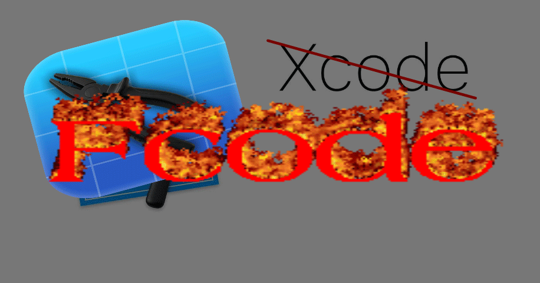

# FCode

An Xcode-like IDE for Windows: write Swift/SwiftUI, build `.ipa` via xtool in WSL, no Mac required.

> [!WARNING]
> **EARLY DEVELOPMENT STAGE.** 
> This is **not** a full Xcode replacement. 
> Expect bugs, missing features, and a manual setup process.  
> No Simulator.

  

## First run

| # | Step | Where |
| :--- | :--- | :--- |
| 1 | `wsl --install --no-distribution`, reboot | PowerShell (admin) |
| 2 | `wsl --install -d Ubuntu` | PowerShell |
| 3 | Install Swift 6.1 | WSL |
| 4 | `sudo apt-get install -y usbmuxd libimobiledevice-utils` | WSL |
| 5 | Download xtool AppImage | WSL |
| 6 | `winget install usbipd` + `usbipd attach --wsl` | PowerShell |
| 7 | Xcode.xip (~10 GB) from [developer.apple.com](https://download.developer.apple.com/Developer_Tools/Xcode_16.4/Xcode_16.4.xip) | Windows |
| 8 | `xtool setup` → Password mode → path to `Xcode.xip` | WSL |
| 9 | `xtool auth` | WSL |

## What is this?

FCode covers the whole iOS development loop on Windows, except the part where Apple's toolchain is physically required.

- **FCode** — editing, project creation, `.ipa` packaging, verification
- **xtool** in WSL — actual Swift/ObjC compilation, signing, install
- **No Mac needed** at any step

What doesn't exist: a native Windows iOS toolchain. Apple ships `clang`, `ld64`, `codesign` only for macOS. So compilation goes through [xtool](https://github.com/xtool-org/xtool) inside WSL.

---

*FCode was built with DeepSeek V4.1 Flash over one week — about $10 total.*

## Building example

  <video src="https://github.com/user-attachments/assets/f99ef03e-98b7-4168-a715-0c893a9e0ae8" width="566" controls></video>

